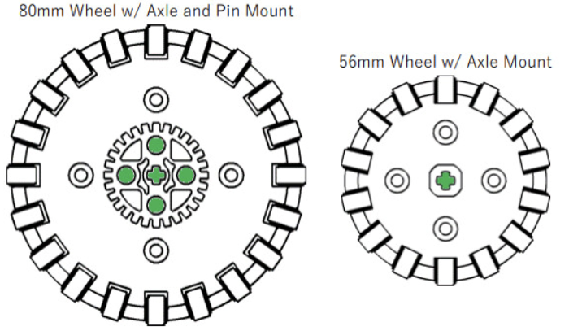

# Omni-Wheels and Replacement Rollers

ABW omni-wheels let a LEGO® robot drive sideways and diagonally as well as forwards, which is how most RoboCup Junior Soccer robots move. They come in two sizes, each matching the diameter of a standard LEGO wheel, so they swap straight in without changing your gearing or ground clearance.

!!! info "At a glance"
    - **Sizes:** 80 mm and 56 mm, sold in pairs
    - **Fits:** standard LEGO® cross axles. The 80 mm wheel also has pin holes
    - **Works with:** LEGO® SPIKE™ Prime, MINDSTORMS® EV3 and NXT robots
    - **Typical uses:** RoboCup Junior, WRO and FIRST LEGO League robots
    - **Shop:** [80 mm pair](https://advancedbotworks.com/products/ABW-80-mm-Omni-Wheels-for-LEGO-r-Pair-p630223252) · [56 mm pair](https://advancedbotworks.com/products/ABW-56-mm-Omni-Wheels-for-LEGO-r-Pair-p630141018) · [Replacement rollers (80-pack)](https://advancedbotworks.com/products/ABW-Omni-Wheel-Replacement-Rollers-80-pack-p631873832)

*Mounting holes. Green: cross-axle hole (both wheels) and the four pin holes on the 80 mm wheel.*

## Specifications

Design release 2 (February 2024).

| | 80 mm wheel | 56 mm wheel |
|---|---|---|
| Outside diameter | 80 ± 1 mm | 56 ± 1 mm |
| Thickness | 8 ± 0.4 mm | 8 ± 0.4 mm |
| Weight (each wheel) | 25 ± 2 g | 16 ± 2 g |
| Rollers per wheel | 20 | 14 |
| Mounting | 1 × cross axle, 4 × pin | 1 × cross axle |

### Limits (both sizes)

| | |
|---|---|
| Maximum load per wheel | 500 g |
| Maximum speed | 600 RPM |
| Maximum motor torque | 0.6 N·m |

### Materials

| Part | Material |
|---|---|
| Wheel hub | ABS plastic |
| Rollers | Silicone tyre (Shore 50A) on an ABS plastic core |
| Roller loop | ABS plastic |

## Mounting

- **Both sizes** fit any standard LEGO® cross axle, like a normal LEGO wheel.
- **80 mm wheel:** the four pin holes around the axle let you add LEGO pins as well as the axle. Use them where the wheel takes high torque, so the load isn't all on the axle.
- **Driving straight:** omni-wheels roll freely sideways, so the robot needs at least three wheels (usually three or four, at angles to each other) to drive in a controlled direction. Your code then sets each motor's speed to choose the direction of travel.
- **Code changes:** each wheel matches the diameter of the LEGO wheel of the same size, so distance and speed calculations based on the LEGO wheel still apply.

## Replacement rollers

Rollers wear over time, especially on rough surfaces. The [80-pack of replacement rollers](https://advancedbotworks.com/products/ABW-Omni-Wheel-Replacement-Rollers-80-pack-p631873832) fits **both** wheel sizes: the 80 mm and 56 mm wheels use the same rollers.

| | 80 mm wheel | 56 mm wheel |
|---|---|---|
| Rollers per wheel | 20 | 14 |
| Wheels one 80-pack can fully re-roll | 4 | 5 |

### Replacing rollers

The rollers sit on an inner ring (the loop) held between the front and back halves of the wheel. You'll need a small screwdriver that fits the wheel's screws.

1. **Take the wheel off the robot.**
2. **Remove all the screws** from the wheel and put them somewhere safe. They're small and easy to lose.
3. **Separate the front and back halves.** The loop of rollers comes away with them.
4. **Slide the old rollers off the loop** and slide the new ones on, until the loop has its full set (20 for the 80 mm wheel, 14 for the 56 mm wheel).
5. **Put the loop back** between the two halves, with each roller sitting in its slot.
6. **Refit the screws.** Tighten them evenly until snug, but don't overtighten them: the wheel is plastic.
7. **Check each roller spins freely** before putting the wheel back on the robot. If one sticks, loosen the screws slightly and re-seat it.

!!! tip
    If one roller is worn, the others usually are too. Replacing a whole wheel's set at once keeps the grip even.

### Making rollers last longer

- Avoid driving on hard, abrasive surfaces such as concrete or rough tiles. Competition carpet and felt mats are fine.
- Replace worn or flat-spotted rollers in sets, so all wheels grip evenly.

## Safety

!!! warning "Warnings"
    - **Choking hazard:** wheels release small pieces if broken, and spare rollers are small parts. Not for young children. Not a toy; suitable for ages 14+.
    - **Injury:** not for carrying people or animals, or supporting them in any way.
    - **Motors:** not for use with the LEGO® high-power buggy motor (part 42908), or with any non-LEGO® motors or parts. These can exceed the wheel's torque and speed limits.

## Still to confirm

- [ ] Photos for the roller replacement steps
- [ ] Screwdriver type and size for the wheel screws
- [ ] Photo of each wheel mounted on a SPIKE Prime motor

---

LEGO®, SPIKE™ and MINDSTORMS® are trademarks of the LEGO Group, which does not sponsor, authorise or endorse these products.
